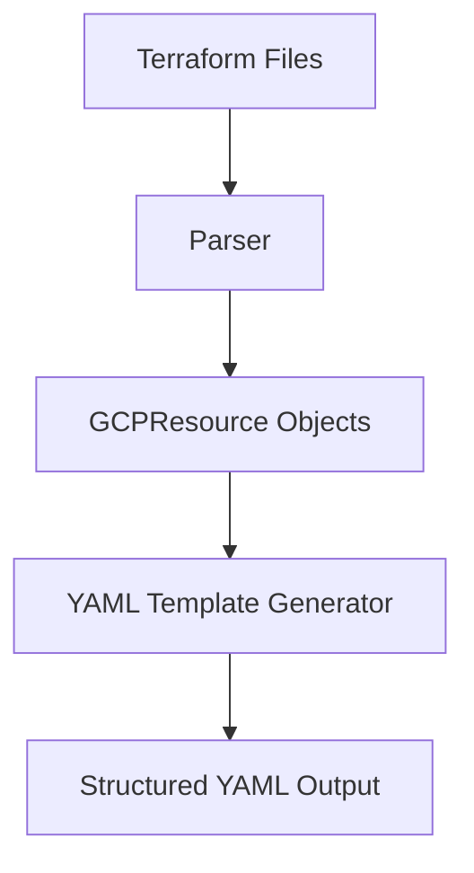
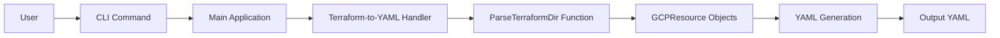
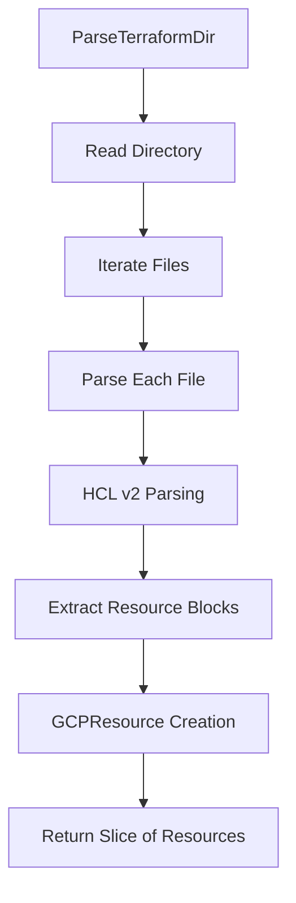

# Taralizer Product Requirements Definition (PRD)

## 1. Executive Summary

Taralizer is a tool designed to analyze Terraform configurations and generate architectural diagrams and technical asset inventories. It focuses on extracting information from GCP Terraform files to create structured output that can be used for security analysis, compliance checking, and infrastructure documentation.

## 2. Product Vision

To provide developers and infrastructure teams with a powerful tool that automates the extraction and visualization of GCP infrastructure configurations from Terraform files, enabling better understanding, auditing, and documentation of cloud architectures.

## 3. Target Audience

- Infrastructure engineers
- DevOps teams
- Security analysts
- Cloud architects
- Compliance officers

## 4. Key Features

### 4.1 Terraform to YAML Conversion
**Feature**: Convert GCP Terraform configuration files into structured YAML format

**Description**: The core functionality of Taralizer that parses Terraform files and converts them into a structured YAML representation for easier analysis and documentation.

**User Story**: As an infrastructure engineer, I want to convert my Terraform configuration files into YAML format so that I can easily analyze and document my GCP infrastructure.

**Mermaid Diagram - Feature Architecture**:


### 4.2 CLI Interface
**Feature**: Command-line interface for easy tool usage

**Description**: A user-friendly command-line interface built with Cobra that allows users to interact with Taralizer through simple commands.

**User Story**: As a DevOps engineer, I want to use Taralizer through simple CLI commands so that I can integrate it easily into my existing workflows.

**Mermaid Diagram - CLI Flow**:


### 4.3 Terraform Parsing
**Feature**: Parse Terraform files using HCL v2

**Description**: The tool leverages HashiCorp's HCL v2 parsing library to accurately extract resource information from Terraform configuration files.

**User Story**: As a cloud architect, I want Taralizer to parse my Terraform files accurately so that I can trust the extracted information for documentation and analysis.

**Mermaid Diagram - Parsing Process**:


## 5. Technical Requirements

### 5.1 Core Components
- **Main Application**: Entry point with Cobra CLI interface
- **Parser Module**: HCL v2 parser for Terraform files  
- **Resource Types**: GCPResource struct definition
- **YAML Generator**: Component for creating structured YAML output

### 5.2 Technology Stack
- **Language**: Go (1.20+)
- **Parsing Library**: HashiCorp HCL v2
- **Command Line Interface**: Cobra
- **Testing Framework**: testify/assert
- **Documentation**: Mermaid diagrams

### 5.3 File Structure
```
.
├── main.go
├── cmd/
│   └── root.go
├── pkg/
│   ├── terraform/
│   │   ├── parser.go
│   │   ├── types.go
│   │   ├── mapping.go
│   │   ├── template_generator.go
│   │   └── parser_test.go
└── docs/
    └── prd.md
```

## 6. Usage Examples

> **Note (Phase A5):** the `terraform-to-yaml` command shown below was part of the original prototype and has been **removed**. The current import path is `taralizer terraform import <dir> -o model.yaml` (see §13.2). The examples below are retained for historical reference only.

### 6.1 Basic Usage
```bash
# Generate YAML from Terraform files in a directory
./taralizer terraform-to-yaml --directory /path/to/terraform/files

# Show help for the command
./taralizer terraform-to-yaml --help
```

### 6.2 Integration Example
```bash
# Process multiple directories and generate reports
./taralizer terraform-to-yaml --directory ./prod-env \
  --output ./reports/prod-inventory.yaml

# Process with verbose output
./taralizer terraform-to-yaml --directory ./dev-env \
  --verbose
```

## 7. Success Metrics

- **Accuracy**: 95%+ accuracy in parsing Terraform files
- **Performance**: Parse large Terraform directories within 5 seconds
- **Usability**: CLI commands should be intuitive and well-documented
- **Compatibility**: Support for all major GCP Terraform resources

## 8. Constraints and Assumptions

### 8.1 Technical Constraints
- Must be written in Go for cross-platform compatibility
- Requires HCL v2 library for parsing Terraform files
- Must maintain backward compatibility with existing command structure

### 8.2 Assumptions
- Users have basic understanding of Terraform and GCP infrastructure
- Terraform files are properly formatted and valid
- Target environment supports Go 1.20+

## 9. Future Enhancements

### 9.1 Planned Features
- Support for other cloud providers (AWS, Azure)
- Graph visualization of infrastructure dependencies
- Compliance checking against security frameworks
- Integration with CI/CD pipelines

### 9.2 Technical Improvements
- Enhanced error handling and reporting
- Performance optimizations for large configurations
- Additional output formats (JSON, HTML)
- Unit test coverage improvement

## 10. Risks and Mitigations

### 10.1 Technical Risks
- **Risk**: Parsing failures with complex Terraform configurations  
  **Mitigation**: Comprehensive testing with various Terraform scenarios

- **Risk**: Performance issues with large infrastructure files
  **Mitigation**: Profiling and optimization of parsing algorithms

### 10.2 Business Risks
- **Risk**: Competition from established infrastructure tools
  **Mitigation**: Focus on unique value proposition of YAML generation

## 11. Dependencies

- HashiCorp HCL v2 library
- Cobra CLI framework  
- testify for testing
- Go 1.20+ toolchain

## 12. Release Notes

### Version 1.0.0 (Current)
- Initial release with core Terraform parsing capabilities
- YAML generation functionality  
- Basic CLI interface with terraform-to-yaml command

## 13. Phase A1: Terraform Export (Model → Infrastructure)

> The sections above describe the original import-only prototype. Phase A1 adds the reverse direction: a taralizer model can now be rendered into Terraform scaffolds, closing the loop between security architecture and infrastructure-as-code.

### 13.1 Feature: Export a Model to Terraform
**Feature**: Render a taralizer model's technical assets and trust boundaries into Terraform scaffold files

**Description**: `taralizer terraform export <model.yaml>` maps each model object's technology to a GCP resource type via the mapping profile (`profiles/google.yaml`) and writes one scaffold file per object, plus shared `provider.tf` / `variables.tf`. Every exported resource carries a marker comment (`# taralizer:asset=<id>` / `# taralizer:boundary=<id>`) so later drift detection can map infrastructure back to the model. The HCL address of each exported object is written back into the model's `terraform_ref` field (disable with `--write-back=false`).

**User Story**: As a security architect, I want to export my reviewed taralizer model as Terraform scaffolds so that the approved architecture becomes a starting point for real infrastructure, and I can later detect drift between model and code.

**Behavioral guarantees**:
- Objects whose technology is missing or unmapped produce a warning on stderr — they are never dropped silently.
- The target directory must be empty (or `--force`) and HCL resource names must not collide; otherwise nothing is written.
- Scaffold output is validated in CI with `terraform validate` (`make check-tf`).

### 13.2 CLI Changes (Phases A1–A3)
```console
taralizer terraform export <model.yaml> [-o dir] [--profile p] [--force] [--write-back=false]
taralizer terraform import <terraform_dir> -o model.yaml [--profile p]
taralizer terraform drift <model.yaml> <terraform_dir> [--profile p] [-o report.md]
```
The former top-level `terraform` command is now a parent grouping `export`, `import` and `drift`. Import (Phase A2) builds a real taralizer model from every `.tf` file in a directory: each mapped resource becomes an asset or boundary with its HCL address recorded as `terraform_ref`, so export → import round-trips. Drift (Phase A3) compares a model with a Terraform directory and exits non-zero on any structural drift, so it gates CI pipelines. With `--profile` (Phase A4) it also compares model-declared attributes of security-relevant technical assets against the static Terraform literals, so attribute drift gates CI too.

### 13.3 Roadmap Continuation (Phases A2–A4)
- **Phase A2**: directory-based import building a real report from Terraform files (drift engine foundation). *Done: `ImportFromDir` + CLI, parser robustness (heredoc normalization + corpus), legacy single-file import removed.*
- **Phase A3**: structural drift report — missing assets, broken refs, unmodeled resources, stale markers — rendered as markdown via `taralizer terraform drift`; exit code 0 ⇔ in sync, non-zero on any finding (CI gate). *Done: `DetectDrift` + markdown report + CLI, see §14.*
- **Phase A4**: attribute-level drift for security-relevant technical assets — compare model-declared attributes (e.g. encryption, public access, network exposure) against the corresponding Terraform resource arguments; profile-driven attribute relevance per technology. *Done: `DetectDrift` takes an optional mapping profile; non-literal Terraform values warn rather than drift; see §15.*
- **Phase A5**: remove the legacy `hashicorp/hcl/v2` parse path and the `terraform-to-yaml` subcommand (superseded by the ANTLR parser + `terraform import`), dropping the HCL dependency. *Done: single ANTLR parser, single import path; see §16.*

## 14. Phase A3: Structural Drift Gate (Model ↔ Infrastructure)

> Phase A3 closes the loop opened by export markers and `terraform_ref` write-back: it answers "does my Terraform still match the reviewed model?" at the structural level, and blocks merges when it does not.

### 14.1 Feature: Detect Structural Drift Between Model and Terraform
**Feature**: Compare a taralizer model with a directory of Terraform files and report structural drift as markdown, exiting non-zero on any finding

**Description**: `taralizer terraform drift <model.yaml> <terraform_dir>` classifies discrepancies into four categories — **missing assets** (model `terraform_ref` with no matching resource), **broken refs** (malformed `terraform_ref` values), **unmodeled resources** (Terraform resources no model entry references) and **stale markers** (export markers whose id is gone from the model). The markdown report goes to stdout or `-o <file>`.

**User Story**: As a security architect, I want my CI pipeline to fail when Terraform drifts structurally from the reviewed taralizer model, so that unreviewed infrastructure changes are caught before merge instead of discovered in a later audit.

**Behavioral guarantees**:
- Exit code 0 ⇔ no findings; any finding produces a non-zero exit (CI gate contract).
- Model entries without a `terraform_ref` are not checked — no linkage, no drift.
- `terraform_ref` is the sole model↔Terraform linkage for unmodeled detection; markers only feed stale-marker detection.
- Files with HCL syntax errors abort the run with an error (consistent with import) — drift is never reported on a partially parsed tree.
- The clean round-trip holds: a model exported with `terraform export` (write-back on) drifts clean against its own exported directory.

### 14.2 Out of Scope (deferred to Phase A4)
Attribute-level drift — comparing model-declared attributes of security-relevant technical assets (encryption, public access, network exposure, …) against Terraform resource arguments — is explicitly out of scope for Phase A3. It requires profile-driven attribute relevance per technology and lands as **Phase A4** (see §13.3).

## 15. Phase A4: Attribute-Level Drift (security-relevant technical assets)

> Phase A4 extends the structural drift gate to the attribute level: it answers "does my Terraform still match the *values* I reviewed for security-relevant assets?" — not just "do the same resources exist?".

### 15.1 Feature: Detect Attribute Drift on Security-Relevant Technical Assets
**Feature**: For technical assets whose technology declares attribute relevance in the mapping profile, compare each model-declared attribute value against the static Terraform literal at the profile-declared path; report mismatches as drift and exit non-zero.

**Description**: `taralizer terraform drift <model.yaml> <terraform_dir> --profile profiles/google.yaml` adds an **attribute drift** category to the Phase A3 structural report. The mapping profile declares, per technology, which attributes are security-relevant and at which Terraform argument path to read them (e.g. `can_ip_forward` for compute instances, `settings.require_ssl` and `settings.ip_configuration.ipv4_enabled` for Cloud SQL). The model declares the expected value per attribute (`TechnicalAsset.Attributes`). A mismatch is a finding; a Terraform value that cannot be read statically (a `var.x` reference, function call, collection, or heredoc) is a warning, not a finding.

**User Story**: As a security architect, I want my CI pipeline to fail when a security-relevant attribute of an asset (e.g. "requires SSL", "IP forwarding enabled") drifts from the value I reviewed in the model, so that silent weakening of a control is caught before merge.

**Behavioral guarantees**:
- The Phase A3 exit-code contract holds unchanged: **any** finding — structural or attribute — makes the gate exit non-zero.
- Attribute drift is only checked when `--profile` is supplied; without it, detection is structural only (backward compatible).
- Only technical assets whose technology declares `attributes` in the profile are checked; an asset that does not declare a given attribute is simply not compared for it (absence is not drift).
- A Terraform value that is not a static literal (reference, function call, collection, heredoc) produces a warning — the value cannot be determined statically, so it is never reported as drift.
- Attribute comparison reuses the Phase A3 linkage: an asset must be linked via a well-formed `terraform_ref` to an existing resource before its attributes are compared (missing/broken refs remain structural findings).

### 15.2 Out of Scope
- Attribute drift for trust boundaries (only technical assets carry declared attributes, per the PRD scope).
- Comparison of non-literal (dynamic) Terraform values — these warn rather than drift.
- Importing attribute values from Terraform into the model (import remains structural; attributes are declared in the model, not inferred).

## 16. Phase A5: Removal of Legacy HCL Parse + `terraform-to-yaml` Subcommand

> Phase A5 is a cleanup phase: it removes the original `hashicorp/hcl/v2` parse path and its `terraform-to-yaml` subcommand, which were superseded by the ANTLR parser (Phase A2) and `terraform import`. The goal is a single Terraform parser and a single import path (KISS).

### 16.1 What Was Removed
- The `terraform-to-yaml` subcommand (`cmd/root.go`) — the only CLI consumer of the legacy path.
- The HCL v2 parse functions `ParseTerraform` (`pkg/terraform/parser.go`) and `ParseTerraformDir` + `GCPResource` (`pkg/terraform/types.go`).
- The legacy template generator `GenerateFromTerraform` / `GenerateTaralizerTemplate` (`pkg/terraform/template_generator.go`).
- The dead helpers/types `ResourceToAssetMapping`, local `TaralizerAsset`/`TrustBoundary` (`pkg/terraform/mapping.go`).
- The `hashicorp/hcl/v2` dependency (`go.mod`/`go.sum`, via `go mod tidy`).

### 16.2 Behavioral Guarantees
- The ANTLR parser is now the sole Terraform parser; `terraform import` and `terraform drift` are the only Terraform-facing commands.
- No user-facing behavior of the remaining commands changes — this is a pure removal of superseded code.
- The `examples/gcp` fixtures are retained (shared by other tests).

---

This PRD serves as the foundation for development and ensures all stakeholders have a clear understanding of Taralizer's purpose, features, and implementation approach.