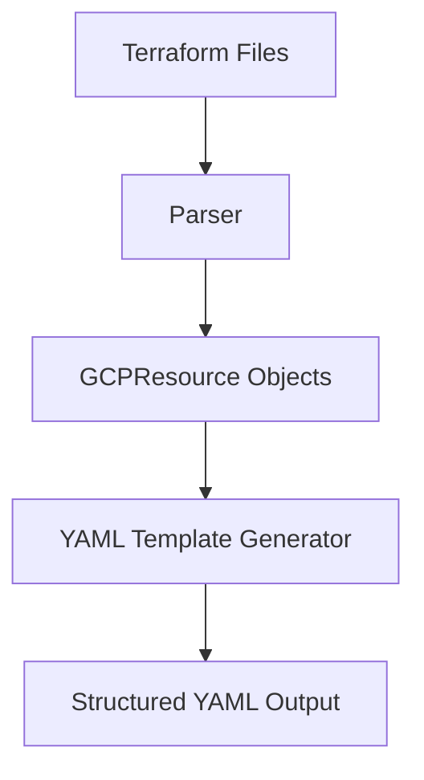
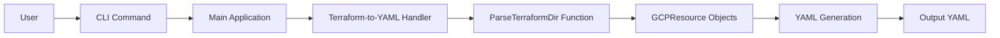
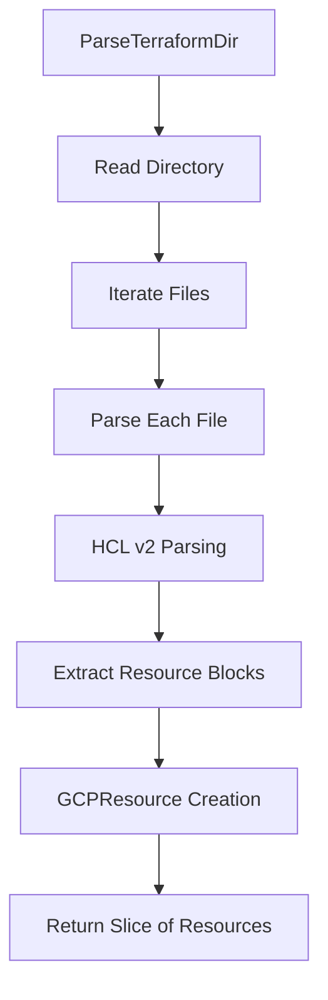

# Taralizer Product Requirements Definition (PRD)

## 1. Executive Summary

Taralizer is a tool designed to analyze Terraform configurations and generate architectural diagrams and technical asset inventories. It focuses on extracting information from GCP Terraform files to create structured output that can be used for security analysis, compliance checking, and infrastructure documentation.

## 2. Product Vision

To provide developers and infrastructure teams with a powerful tool that automates the extraction and visualization of GCP infrastructure configurations from Terraform files, enabling better understanding, auditing, and documentation of cloud architectures.

## 3. Target Audience

- Infrastructure engineers
- DevOps teams
- Security analysts
- Cloud architects
- Compliance officers

## 4. Key Features

### 4.1 Terraform to YAML Conversion
**Feature**: Convert GCP Terraform configuration files into structured YAML format

**Description**: The core functionality of Taralizer that parses Terraform files and converts them into a structured YAML representation for easier analysis and documentation.

**User Story**: As an infrastructure engineer, I want to convert my Terraform configuration files into YAML format so that I can easily analyze and document my GCP infrastructure.

**Mermaid Diagram - Feature Architecture**:


### 4.2 CLI Interface
**Feature**: Command-line interface for easy tool usage

**Description**: A user-friendly command-line interface built with Cobra that allows users to interact with Taralizer through simple commands.

**User Story**: As a DevOps engineer, I want to use Taralizer through simple CLI commands so that I can integrate it easily into my existing workflows.

**Mermaid Diagram - CLI Flow**:


### 4.3 Terraform Parsing
**Feature**: Parse Terraform files using HCL v2

**Description**: The tool leverages HashiCorp's HCL v2 parsing library to accurately extract resource information from Terraform configuration files.

**User Story**: As a cloud architect, I want Taralizer to parse my Terraform files accurately so that I can trust the extracted information for documentation and analysis.

**Mermaid Diagram - Parsing Process**:


## 5. Technical Requirements

### 5.1 Core Components
- **Main Application**: Entry point with Cobra CLI interface
- **Parser Module**: HCL v2 parser for Terraform files  
- **Resource Types**: GCPResource struct definition
- **YAML Generator**: Component for creating structured YAML output

### 5.2 Technology Stack
- **Language**: Go (1.20+)
- **Parsing Library**: HashiCorp HCL v2
- **Command Line Interface**: Cobra
- **Testing Framework**: testify/assert
- **Documentation**: Mermaid diagrams

### 5.3 File Structure
```
.
├── main.go
├── cmd/
│   └── root.go
├── pkg/
│   ├── terraform/
│   │   ├── parser.go
│   │   ├── types.go
│   │   ├── mapping.go
│   │   ├── template_generator.go
│   │   └── parser_test.go
└── docs/
    └── prd.md
```

## 6. Usage Examples

### 6.1 Basic Usage
```bash
# Generate YAML from Terraform files in a directory
./taralizer terraform-to-yaml --directory /path/to/terraform/files

# Show help for the command
./taralizer terraform-to-yaml --help
```

### 6.2 Integration Example
```bash
# Process multiple directories and generate reports
./taralizer terraform-to-yaml --directory ./prod-env \
  --output ./reports/prod-inventory.yaml

# Process with verbose output
./taralizer terraform-to-yaml --directory ./dev-env \
  --verbose
```

## 7. Success Metrics

- **Accuracy**: 95%+ accuracy in parsing Terraform files
- **Performance**: Parse large Terraform directories within 5 seconds
- **Usability**: CLI commands should be intuitive and well-documented
- **Compatibility**: Support for all major GCP Terraform resources

## 8. Constraints and Assumptions

### 8.1 Technical Constraints
- Must be written in Go for cross-platform compatibility
- Requires HCL v2 library for parsing Terraform files
- Must maintain backward compatibility with existing command structure

### 8.2 Assumptions
- Users have basic understanding of Terraform and GCP infrastructure
- Terraform files are properly formatted and valid
- Target environment supports Go 1.20+

## 9. Future Enhancements

### 9.1 Planned Features
- Support for other cloud providers (AWS, Azure)
- Graph visualization of infrastructure dependencies
- Compliance checking against security frameworks
- Integration with CI/CD pipelines

### 9.2 Technical Improvements
- Enhanced error handling and reporting
- Performance optimizations for large configurations
- Additional output formats (JSON, HTML)
- Unit test coverage improvement

## 10. Risks and Mitigations

### 10.1 Technical Risks
- **Risk**: Parsing failures with complex Terraform configurations  
  **Mitigation**: Comprehensive testing with various Terraform scenarios

- **Risk**: Performance issues with large infrastructure files
  **Mitigation**: Profiling and optimization of parsing algorithms

### 10.2 Business Risks
- **Risk**: Competition from established infrastructure tools
  **Mitigation**: Focus on unique value proposition of YAML generation

## 11. Dependencies

- HashiCorp HCL v2 library
- Cobra CLI framework  
- testify for testing
- Go 1.20+ toolchain

## 12. Release Notes

### Version 1.0.0 (Current)
- Initial release with core Terraform parsing capabilities
- YAML generation functionality  
- Basic CLI interface with terraform-to-yaml command

This PRD serves as the foundation for development and ensures all stakeholders have a clear understanding of Taralizer's purpose, features, and implementation approach.