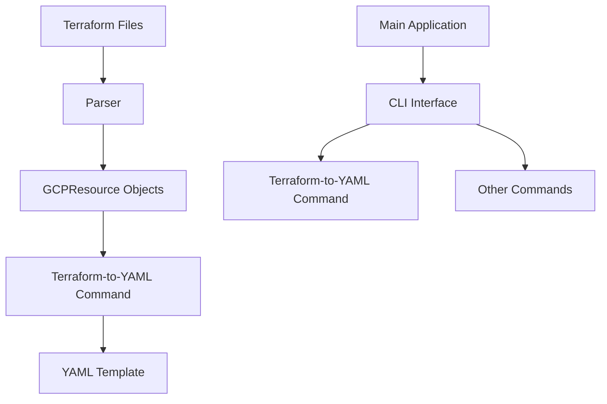
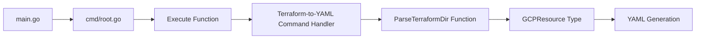
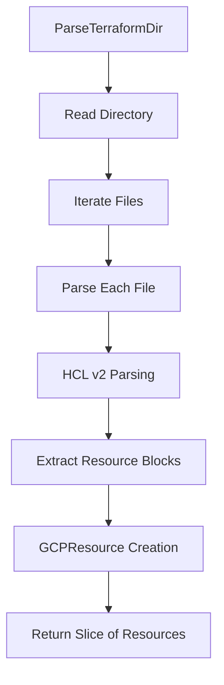
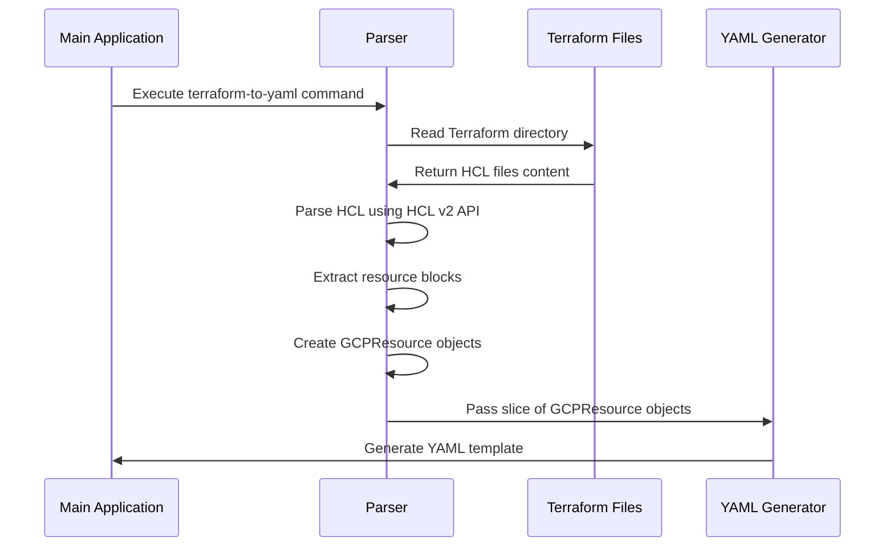

# Taralizer Architecture Specification

## Overview

Taralizer is a tool designed to analyze Terraform configurations and generate architectural diagrams and technical asset inventories. It focuses on extracting information from GCP Terraform files to create structured output that can be used for security analysis, compliance checking, and infrastructure documentation.

## Architecture Diagram



## Component Details

### 1. Main Application Structure



### 2. Terraform Parsing Process



### 3. Data Flow



## Key Components

### 1. GCPResource Type

The `GCPResource` type is defined in `pkg/terraform/types.go` and contains the following fields:

```go
type GCPResource struct {
	Type string
	Name string
	// Additional fields can be added as needed for more complex scenarios
}
```

### 2. Parser Functions

#### ParseTerraformDir Function
- Located in `pkg/terraform/parser.go`
- Takes a directory path as input
- Parses all Terraform files in the directory
- Returns a slice of `GCPResource` objects

#### ParseTerraform Function  
- Located in `pkg/terraform/parser.go`
- Takes a single file path as input
- Parses the specific Terraform file
- Returns a slice of `GCPResource` objects

### 3. CLI Interface

The main application is structured using Cobra for command-line interface management:
- `main.go` - Entry point
- `cmd/root.go` - Root command with Execute function
- Commands are registered in the root command

### 4. YAML Generation

The `terraform-to-yaml` command uses the parsed GCP resources to generate a structured YAML template that can be used for further analysis or documentation.

## Data Flow

1. User executes `taralizer terraform-to-yaml` command
2. CLI interface parses the arguments and calls `ParseTerraformDir`
3. `ParseTerraformDir` reads the specified directory and processes all Terraform files
4. Each file is parsed using HCL v2 API to extract resource blocks  
5. Resource information is converted into `GCPResource` objects
6. The slice of resources is passed to the YAML generation component
7. A structured YAML template is generated and output

## Technology Stack

- **Language**: Go
- **Parsing Library**: HashiCorp HCL v2
- **Command Line Interface**: Cobra
- **Testing Framework**: testify/assert
- **Documentation Generation**: Mermaid diagrams

## File Structure

```
.
├── main.go
├── cmd/
│   └── root.go
├── pkg/
│   ├── terraform/
│   │   ├── parser.go
│   │   ├── types.go
│   │   ├── mapping.go
│   │   ├── template_generator.go
│   │   └── parser_test.go
└── docs/
    └── spec.md
```

## Usage Example

```bash
# Generate YAML from Terraform files in a directory
./taralizer terraform-to-yaml --directory /path/to/terraform/files

# Show help for the command
./taralizer terraform-to-yaml --help
```

## Phase A1: Model → Terraform Export (supersedes the HCL v2 description above)

> Note: the original sections describe the early `terraform-to-yaml` prototype. The parser is now ANTLR-based (grammar in `.antlr`, generated code in `pkg/terraform/*_parser.go` / `*_lexer.go` — excluded from the coverage gate per CONSTRAINTS.md §3), and the Terraform integration is organized as a `terraform` command group. This section documents the current architecture.

### 1. Export Pipeline (`pkg/terraform/export.go`)

```text
taralizer.Report (YAML model)
  → LoadGoogleProfile(profilePath)          # profiles/google.yaml: technology → terraform type + scaffold
  → for each technical asset / trust boundary:
      MapResourceToTechnology(tech)         # nil or empty scaffold ⇒ warning, object skipped (never dropped silently)
      sanitizeHCLName(id)                   # [^a-zA-Z0-9_] → _ ; hyphens normalized to underscores
      gcpResourceName(id)                   # lowercase, hyphenated — GCP names forbid underscores
      render scaffold with {name} → gcpName # HCL label keeps the sanitized name
  → write <hclName>.tf per object + provider.tf + variables.tf
  → return map[id] = HCL address (e.g. "google_compute_network.vpc")
```

Guards: the target directory must not exist or be empty unless `force` is set; duplicate HCL resource names abort the export before anything is written.

### 2. Markers (drift-detection contract, Phase A3)

Each exported resource block is preceded by a marker comment:

```hcl
# taralizer:asset=vpc
resource "google_compute_network" "vpc" {
  name                    = "vpc"
  auto_create_subnetworks = false
}
```

Prefixes are `# taralizer:asset=<id>` and `# taralizer:boundary=<id>` (constants `AssetMarkerPrefix` / `BoundaryMarkerPrefix`). The asset/boundary distinction keeps the mapping unambiguous when an asset id and a boundary id collide.

### 3. Write-back (`WriteBackTerraformRefs`)

After export, each object's HCL address is written into the model file as its `terraform_ref` field (added to `TechnicalAsset` and `TrustBoundary`, `omitempty`). The edit is surgical and line-level (insert below `- id:` or update in place), preserving comments and formatting. It refuses to write if any ref id is missing from the model or if the edited document no longer parses as a `taralizer.Report`. Idempotent: re-running produces no change.

### 4. CLI (`cmd/terraform.go`)

```console
taralizer terraform export <model.yaml> [-o dir] [--profile p] [--force] [--write-back=false]
taralizer terraform import <terraform_dir> -o model.yaml [--profile p]   # Phase A2
```

`terraform` is a parent command (help only). Warnings go to stderr; the exit code reflects export success.

### 5. Scaffolding Rules (profile-driven)

- A technology is exportable iff its profile entry has a non-empty `terraform` resource type **and** a non-empty `scaffold` template.
- The scaffold body is the resource's attribute block; `{name}` renders as the GCP-safe name (lowercase, hyphens), while the HCL resource label uses the sanitized id.
- `provider.tf` (google provider) and `variables.tf` are always written alongside the per-object files.
- Scaffold correctness is gated in CI: `make check-tf` exports the Bank of Anthos example and runs `terraform init -backend=false && terraform validate` (`.github/workflows/test.yml`, job `terraform-validate`).

### 6. Coverage Gate (Phase A1.7)

`make check-coverage` requires ≥ 65% of project code, with generated files (header `// Code generated ... DO NOT EDIT.`) excluded by header detection in `scripts/check-coverage.sh`. Tests must not exist solely to inflate coverage of generated code (CONSTRAINTS.md §3). Current state: ~85% gated.

## Phase A2: Terraform Import (Terraform → Model)

### 1. Import Pipeline (`pkg/terraform/import.go`)

```text
dir/*.tf (walked in lexical order)
  → per file: ANTLR parse (Terraform.g4), syntax errors abort the import
  → per resource block: type + name (labels)
      MapResourceToTechnology(type)   # nil ⇒ warning, skipped (never dropped silently)
      technical_asset  → TechnicalAsset{Id: name, Name: tech.Name, Technology: tech.ID, TerraformRef: type.name}
      trust_boundary   → TrustBoundary{same shape}
  → taralizer.Save(report, outFile)   # YAML model file
```

Guards: the directory must exist and be a directory; duplicate HCL addresses warn and keep the first occurrence. `data`/`locals`/`provider`/`module`/`output` blocks are ignored — only `resource` blocks import. When several technologies share one terraform type (e.g. `google_compute_instance`), the first profile match wins; markers (Phase A3) will disambiguate later.

### 2. Model Persistence (`taralizer.Save`)

`pkg/taralizer/model.go` gained `Save(report, fileName)` — YAML marshal + write, the inverse of `Load`. The import command writes its report through it.

### 3. CLI (`cmd/terraform.go`)

The legacy single-file `import <file>` (which printed to stdout and discarded its report) is replaced by directory-based import: `taralizer terraform import <dir> -o model.yaml [--profile p]`. Warnings go to stderr; the exit code reflects import success. The legacy `Terraform.ImportFromFile` remains in `pkg/terraform/terraform.go` (still tested) until a later deprecation task.

---

This specification outlines the architecture and components of taralizer, providing a clear understanding of how it processes Terraform configurations and generates technical asset inventories.