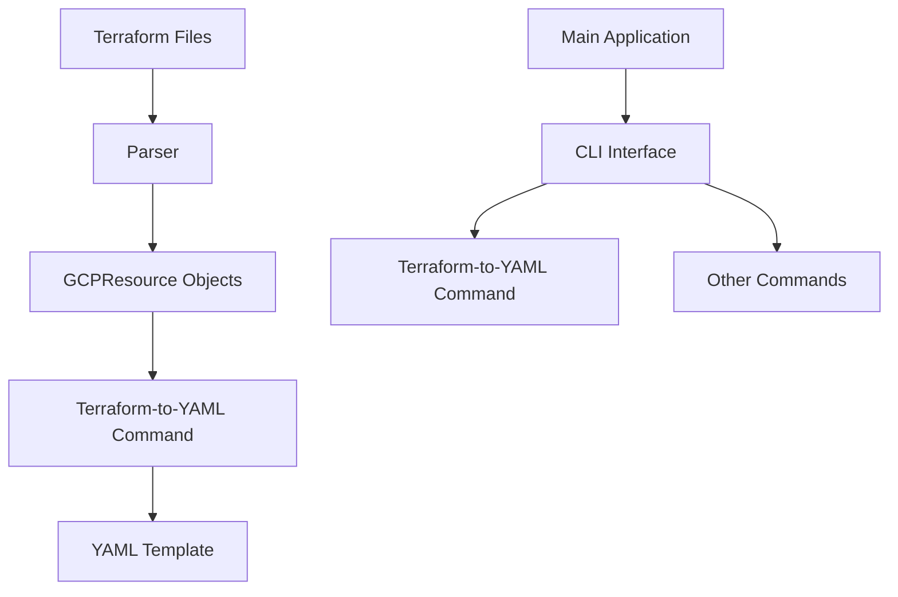
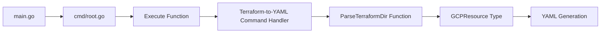
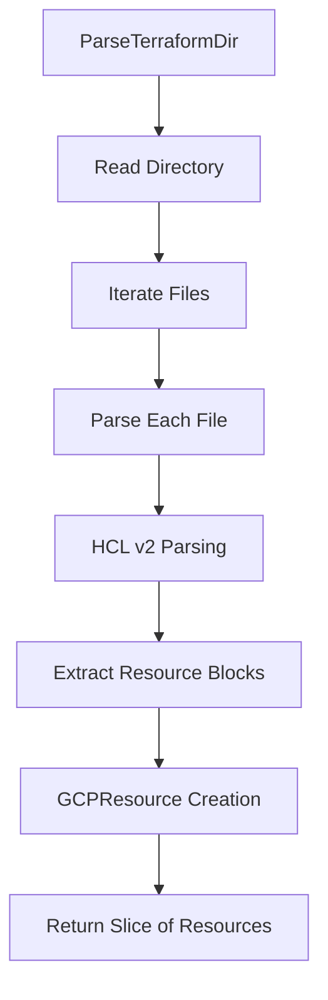
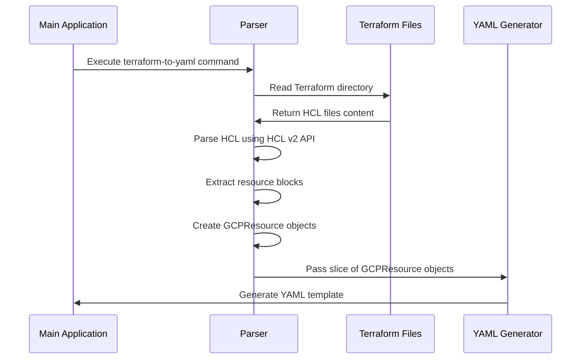

# Taralizer Architecture Specification

## Overview

Taralizer is a tool designed to analyze Terraform configurations and generate architectural diagrams and technical asset inventories. It focuses on extracting information from GCP Terraform files to create structured output that can be used for security analysis, compliance checking, and infrastructure documentation.

## Architecture Diagram



## Component Details

### 1. Main Application Structure



### 2. Terraform Parsing Process



### 3. Data Flow



## Key Components

### 1. GCPResource Type

The `GCPResource` type is defined in `pkg/terraform/types.go` and contains the following fields:

```go
type GCPResource struct {
	Type string
	Name string
	// Additional fields can be added as needed for more complex scenarios
}
```

### 2. Parser Functions

#### ParseTerraformDir Function
- Located in `pkg/terraform/parser.go`
- Takes a directory path as input
- Parses all Terraform files in the directory
- Returns a slice of `GCPResource` objects

#### ParseTerraform Function  
- Located in `pkg/terraform/parser.go`
- Takes a single file path as input
- Parses the specific Terraform file
- Returns a slice of `GCPResource` objects

### 3. CLI Interface

The main application is structured using Cobra for command-line interface management:
- `main.go` - Entry point
- `cmd/root.go` - Root command with Execute function
- Commands are registered in the root command

### 4. YAML Generation

The `terraform-to-yaml` command uses the parsed GCP resources to generate a structured YAML template that can be used for further analysis or documentation.

## Data Flow

1. User executes `taralizer terraform-to-yaml` command
2. CLI interface parses the arguments and calls `ParseTerraformDir`
3. `ParseTerraformDir` reads the specified directory and processes all Terraform files
4. Each file is parsed using HCL v2 API to extract resource blocks  
5. Resource information is converted into `GCPResource` objects
6. The slice of resources is passed to the YAML generation component
7. A structured YAML template is generated and output

## Technology Stack

- **Language**: Go
- **Parsing Library**: HashiCorp HCL v2
- **Command Line Interface**: Cobra
- **Testing Framework**: testify/assert
- **Documentation Generation**: Mermaid diagrams

## File Structure

```
.
├── main.go
├── cmd/
│   └── root.go
├── pkg/
│   ├── terraform/
│   │   ├── parser.go
│   │   ├── types.go
│   │   ├── mapping.go
│   │   ├── template_generator.go
│   │   └── parser_test.go
└── docs/
    └── spec.md
```

## Usage Example

```bash
# Generate YAML from Terraform files in a directory
./taralizer terraform-to-yaml --directory /path/to/terraform/files

# Show help for the command
./taralizer terraform-to-yaml --help
```

This specification outlines the architecture and components of taralizer, providing a clear understanding of how it processes Terraform configurations and generates technical asset inventories.